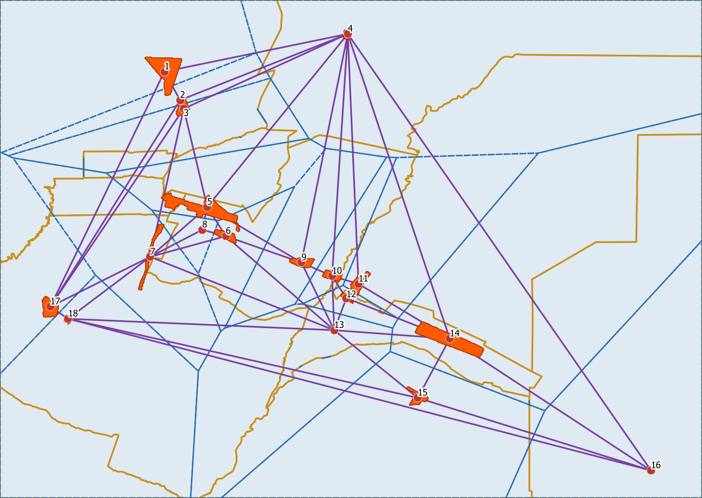

# Módulo 4: QGIS

## Descripción del Proyecto
En este módulo se procesan datos geográficos y alfanuméricos con Sistemas de Información Geográfica (SIG) en **QGIS 3.44**. El objetivo es darle al ingeniero industrial herramientas de análisis espacial para tomar decisiones territoriales y logísticas.

Todo el procesamiento se hizo con **PyQGIS** (la consola de Python de QGIS) y los algoritmos de *Processing*, así que es reproducible. Los mapas web se construyeron con **Leaflet** a partir de las capas exportadas desde QGIS y se publican con GitHub Pages.

---

## Actividad 1: Parques y Zonas Industriales de Mendoza

### Metodología
1. **Raster georreferenciado:** se partió del mapa de parques, zonas y áreas industriales del oasis norte de Mendoza provisto por la cátedra (GeoTIFF en EPSG:4326).
2. **Del raster al vector:** se clasificaron los píxeles de color naranja (superficie industrial) y se vectorizaron con `gdal.Polygonize`, eliminando el ruido con un filtro de tamiz (*sieve*).
3. **Digitalización y tabla de atributos:** se digitalizó un punto por cada parque o zona (18 en total) con los campos `id`, `nom`, `tipo`, `depto` y `sup_ha`. El departamento se asignó por intersección espacial con los límites oficiales del **IGN** (servicio WFS).
4. **Cálculo de superficies:** las áreas se calcularon reproyectando a **EPSG:32719 (WGS 84 / UTM 19S)**, un sistema métrico, para no medir en grados.
5. **Análisis espacial:**
   - **Polígonos de Voronoi:** el área de influencia de cada parque (zona del territorio más cercana a cada uno), recortada al área de estudio.
   - **Triangulación de Delaunay:** la red de vecindad entre parques, con la distancia en km de cada conexión.
6. **Exportación web:** mapa interactivo con conmutación de capas, popups con atributos y el raster original superpuesto.

### Resultados

| id | Parque / zona | Departamento | Superficie (ha)* |
|---|---|---|---|
| 1 | Zona Industrial Cementera | Las Heras | 1.572 |
| 2 | Parque Industrial Minero Eje Norte II | Las Heras | s/d |
| 3 | Parque Industrial Minero Eje Norte (PIMEN) | Las Heras | 356 |
| 4 | Zona Industrial Lavalle | Lavalle | 136 |
| 5 | Zona Industrial Rodríguez Peña | Maipú | 1.880 |
| 6 | Parque Industrial General Ortega | Maipú | 405 |
| 7 | Área Lateral Este del Acceso Sur | Luján de Cuyo | 496 |
| 8 | Zona Industrial Alcoholera | Maipú | 5 |
| 9 | Zona Industrial Carril Gómez | Maipú | 401 |
| 10 | Zona Industrial San Roque | Maipú | 305 |
| 11 | Parque de Servicios e Industrias Palmira | San Martín | 537 |
| 12 | Zona Industrial Fray Luis Beltrán | Junín | 109 |
| 13 | Parque Industrial Los Barriales | Junín | s/d |
| 14 | Zona Industrial San Martín | Junín | 1.921 |
| 15 | Zona Industrial Rivadavia | Rivadavia | 411 |
| 16 | Parque Industrial Santa Rosa | Santa Rosa | 32 |
| 17 | Parque Industrial Provincial | Luján de Cuyo | 584 |
| 18 | Parque Industrial Municipal (Luján de Cuyo) | Luján de Cuyo | 82 |

\* Superficie estimada a partir del mapa de la cátedra (escala regional, resolución de píxel de ~100 m). Es un orden de magnitud, no una medición catastral. "s/d": el parque está en el mapa pero su polígono no se distingue del vecino.

**Conclusiones del análisis espacial:**
- **Maipú concentra 5 de los 18 parques y zonas.** Junto con Las Heras y Luján de Cuyo (3 cada uno) forma el eje industrial del Gran Mendoza.
- **Las áreas de influencia (Voronoi) son muy desiguales.** En el centro del Gran Mendoza son chicas (Alcoholera ~44 km², Fray Luis Beltrán ~40 km²) y en la periferia muy grandes (Lavalle ~1.480 km², San Martín ~1.240 km²). Para una empresa que busca dónde instalarse, la periferia ofrece menos competencia por el suelo pero peor acceso a servicios y proveedores.
- **La red de Delaunay muestra dos agrupamientos:** el Gran Mendoza (Las Heras, Maipú, Luján) y el corredor este por la Ruta Nacional 7 (Palmira, San Martín, Junín, Rivadavia). Santa Rosa y Lavalle quedan aislados: el vecino más cercano de Santa Rosa está a ~35 km (Rivadavia) y el de Lavalle a ~26 km (Eje Norte).

### 🌐 Mapa Web Interactivo
👉 [Ver Mapa Interactivo de Parques Industriales](https://cryptoperi.github.io/TyHMII_Entregas/Modulo%204/mapa%20parques/index.html)

---

## Actividad 2: Variación de la Cobertura de Nieve – Valle de las Lágrimas

### Descripción de la Actividad
Monitoreo ambiental con imágenes satelitales: se cuantificó y comparó la superficie cubierta por nieve en el **Valle de las Lágrimas** (Malargüe, Mendoza) entre dos fechas de la misma época del año, separadas por dos años.

| | Imagen anterior | Imagen actual |
|---|---|---|
| Satélite | Sentinel-2A (Copernicus) | Sentinel-2A (Copernicus) |
| Fecha | 26/10/2024 | 18/10/2026 |
| Producto | L2A (reflectancia de superficie) | L2A (reflectancia de superficie) |
| Escena | S2A_19HCB_20241026_0_L2A | S2A_19HCB_20261018_0_L2A |

### Metodología y Herramientas Aplicadas
1. **Obtención de imágenes:** se descargaron las escenas de Copernicus Sentinel-2 desde el catálogo STAC público *Earth Search* (AWS), leyendo solo el recorte del área de estudio (20 × 20 km centrado en el valle).
2. **Proyección cartográfica:** todo el análisis se hizo en **EPSG:32719 (WGS 84 / UTM 19S)**, un sistema métrico, para que las superficies se midan sin la distorsión de trabajar en grados (EPSG:4326).
3. **Clasificación de nieve:** se calculó el **Índice de Nieve de Diferencia Normalizada**, NDSI = (Verde − SWIR) / (Verde + SWIR), con las bandas B03 y B11 a 20 m. Se clasificó como nieve NDSI > 0,42 con reflectancia verde > 0,10, el umbral estándar del producto de nieve de Sentinel-2 / MODIS.
4. **Máscara de nubes:** se excluyeron los píxeles marcados como nube o sombra en la capa de clasificación de escena (SCL) del producto L2A, para no confundir nubes con nieve.
5. **Vectorización y cálculo de superficies:** la máscara de nieve se filtró (se eliminaron manchas menores a 1 ha), se vectorizó en polígonos y se calculó el área en **hectáreas** (`área / 10.000`).

### Resultados

| | 26/10/2024 | 18/10/2026 |
|---|---|---|
| Superficie con nieve | **33.270 ha** | **39.110 ha** |
| % del área de estudio (40.000 ha) | 83,2 % | 97,8 % |
| Nubes excluidas | 11 ha | 221 ha |

**Variación: +5.840 ha (+17,6 %) de superficie nevada en 2026 respecto de 2024.**

### Análisis
- En octubre de 2026 el valle está casi completamente cubierto, mientras que en 2024, para la misma época, ya asomaban las laderas con orientación norte y el fondo del valle (se ve en la capa de color verdadero del mapa web).
- La diferencia indica una **temporada invernal 2026 con más nieve acumulada o una fusión más tardía** que la de 2024. Para el oasis norte y sur de Mendoza esto importa porque el agua de riego y de uso industrial depende del deshielo.
- **Limitación:** dos fechas aisladas muestran el estado en ese momento, no la tendencia. Para conclusiones climáticas habría que analizar una serie temporal de varias temporadas.

### 🌐 Mapa Web Interactivo
👉 [Ver Mapa Interactivo del Valle de las Lágrimas](https://cryptoperi.github.io/TyHMII_Entregas/Modulo%204/mapa%20nieve/index.html)

---

## 📥 Descargas
Los paquetes incluyen el proyecto de QGIS (`.qgz`) con rutas relativas y todas sus capas:

[Descarga aquí el paquete de la Actividad 1 (.zip)](https://raw.githubusercontent.com/Cryptoperi/TyHMII_Entregas/main/Modulo%204/M4A1.zip): GeoPackage con puntos, polígonos, departamentos, Voronoi y Delaunay, más el raster base.

[Descarga aquí el paquete de la Actividad 2 (.zip)](https://raw.githubusercontent.com/Cryptoperi/TyHMII_Entregas/main/Modulo%204/M4A2.zip): máscaras de nieve (GeoTIFF), polígonos de nieve (GeoJSON) e imágenes Sentinel-2 recortadas.

### Fuentes de datos
- Mapa de parques industriales: material de la cátedra.
- Límites departamentales: Instituto Geográfico Nacional (IGN), servicio WFS.
- Imágenes satelitales: Copernicus Sentinel-2 (ESA), vía Earth Search / AWS Open Data.
- Mapas base: © OpenStreetMap, OpenTopoMap, Esri World Imagery.
