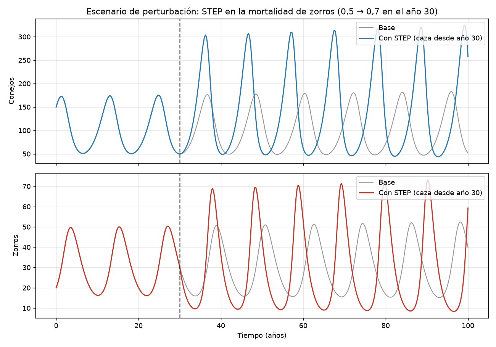

# Módulo 5: Dinámica de Sistemas

## Planteo del Problema: Modelo Presa-Depredador
Se construyó en **Vensim PLE** un modelo de dinámica de sistemas de dos poblaciones que interactúan: **conejos (presas)** y **zorros (depredadores)**, basado en las ecuaciones de **Lotka-Volterra**.

### Estructura del modelo
| Elemento | Tipo | Definición |
|---|---|---|
| Conejos | Nivel (stock) | Valor inicial: 150 animales |
| Zorros | Nivel (stock) | Valor inicial: 20 animales |
| nacimientos de conejos | Flujo | tasa de natalidad × Conejos |
| muertes de conejos | Flujo | tasa de depredación × Conejos × Zorros |
| nacimientos de zorros | Flujo | eficiencia de conversión × tasa de depredación × Conejos × Zorros |
| muertes de zorros | Flujo | tasa de mortalidad × Zorros |

| Parámetro | Valor | Unidad |
|---|---|---|
| Tasa de natalidad de conejos | 0,6 | 1/año |
| Tasa de depredación | 0,02 | 1/(animal·año) |
| Eficiencia de conversión | 0,25 | adimensional |
| Tasa de mortalidad de zorros | 0,5 | 1/año |

Horizonte de simulación: **100 años**, con paso de tiempo de 0,0078125 años (método de Euler).

### Bucles de realimentación
- **Refuerzo (R):** más conejos → más nacimientos de conejos → más conejos.
- **Balance (B1):** más zorros → más conejos cazados → menos conejos.
- **Balance (B2):** más conejos → más alimento → más zorros → más depredación → menos conejos.

## Resultados


- Las poblaciones **oscilan en forma periódica**, con un ciclo de aproximadamente **12 años**.
- Los picos de zorros llegan **con retraso** respecto de los de conejos: primero crecen las presas, luego los depredadores, que hacen caer a las presas y después caen ellos por falta de alimento.
- Los conejos varían entre ~50 y ~180 animales y los zorros entre ~16 y ~52.
- El punto de equilibrio teórico es **100 conejos y 30 zorros** (C* = m / (e·b), Z* = a / b). Como el estado inicial no coincide con él, el sistema gira alrededor de ese punto en lugar de estabilizarse (órbita cerrada en el diagrama de fase).
- El leve aumento de amplitud a lo largo de los 100 años se debe al error numérico del método de Euler, no al comportamiento del sistema.

## Escenario de Perturbación (Función STEP)
Para probar la respuesta del sistema ante un cambio externo, se simuló un **programa de control de zorros** (caza) que comienza en el **año 30**. Se modeló con una función escalón sobre la mortalidad:

```
tasa de mortalidad de zorros = mortalidad base de zorros + STEP(aumento de mortalidad por caza, año de inicio de la caza)
                             = 0,5 + STEP(0,2 ; 30)
```



| Indicador (años 40 a 100) | Base | Con STEP |
|---|---|---|
| Conejos – promedio | 99 | **142** |
| Conejos – pico máximo | 183 | **325** |
| Zorros – promedio | 30 | **29** |
| Zorros – rango | 15 a 52 | **8 a 73** |

### Análisis
- **La caza no reduce la población promedio de zorros.** El equilibrio de zorros depende solo de los parámetros de los conejos (Z* = a / b = 30), así que vuelve al mismo valor.
- **Lo que cambia es la población de conejos.** El equilibrio sube de 100 a 140 (C* = m / (e·b)), porque con menos presión de depredación hay más presas.
- **Las oscilaciones se amplifican.** Los picos de conejos casi se duplican y los zorros pasan por mínimos más bajos (~8), lo que aumenta el riesgo de que la población colapse.
- **El ciclo se acorta**, de ~12 a ~10,5 años.

### Conclusión Técnica
La intervención produce un efecto **contraintuitivo**: lo que se busca controlar (los zorros) en promedio no cambia, y el efecto aparece en otra parte del sistema (los conejos) y en una mayor inestabilidad. Es un ejemplo de por qué en dinámica de sistemas las políticas deben evaluarse sobre la **estructura de realimentación** completa y no solo sobre la variable que se quiere modificar. En un contexto industrial, pasa lo mismo cuando se ajusta un solo eslabón de una cadena con demoras (por ejemplo, el ritmo de producción frente al inventario): se amplifican las oscilaciones en lugar de estabilizarlas.

## 📥 Descargas
[Descarga aquí el modelo base de Vensim (.mdl)](https://raw.githubusercontent.com/Cryptoperi/TyHMII_Entregas/main/Modulo%205/presa_depredador.mdl)

[Descarga aquí el modelo con escenario STEP (.mdl)](https://raw.githubusercontent.com/Cryptoperi/TyHMII_Entregas/main/Modulo%205/presa_depredador_STEP.mdl)

> Los modelos se abren con **Vensim PLE** (gratuito para uso académico).
