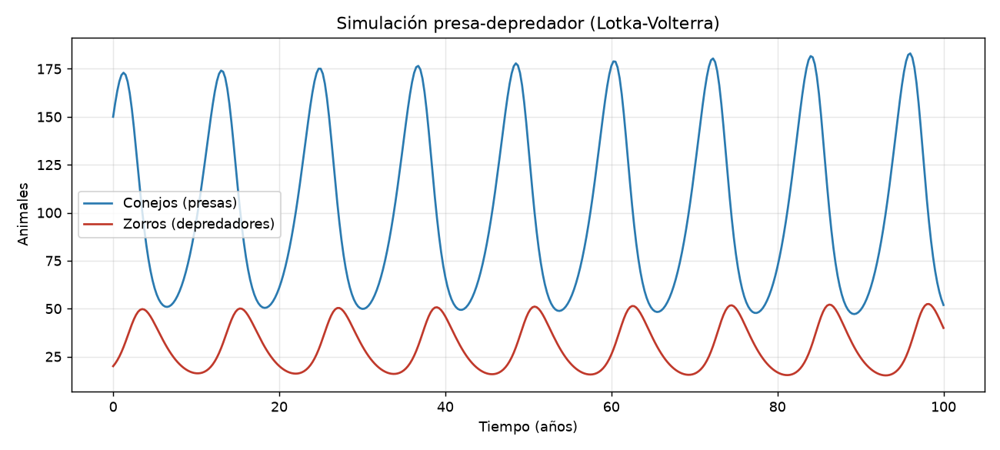
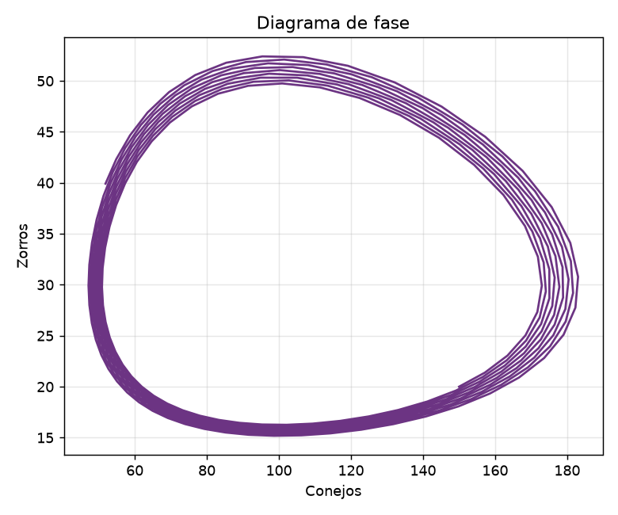

# Módulo 5: Dinámica de Sistemas

## Planteo del Problema: Modelo Presa-Depredador
Se construyó en **Vensim PLE** un modelo de dinámica de sistemas de dos poblaciones que interactúan: **conejos (presas)** y **zorros (depredadores)**, basado en las ecuaciones de **Lotka-Volterra**.

### Estructura del modelo
| Elemento | Tipo | Definición |
|---|---|---|
| Conejos | Nivel (stock) | Valor inicial: 150 animales |
| Zorros | Nivel (stock) | Valor inicial: 20 animales |
| nacimientos de conejos | Flujo | tasa de natalidad × Conejos |
| muertes de conejos | Flujo | tasa de depredación × Conejos × Zorros |
| nacimientos de zorros | Flujo | eficiencia de conversión × tasa de depredación × Conejos × Zorros |
| muertes de zorros | Flujo | tasa de mortalidad × Zorros |

| Parámetro | Valor | Unidad |
|---|---|---|
| Tasa de natalidad de conejos | 0,6 | 1/año |
| Tasa de depredación | 0,02 | 1/(animal·año) |
| Eficiencia de conversión | 0,25 | adimensional |
| Tasa de mortalidad de zorros | 0,5 | 1/año |

Horizonte de simulación: **100 años**, con paso de tiempo de 0,0078125 años (método de Euler).

### Bucles de realimentación
- **Refuerzo (R):** más conejos → más nacimientos de conejos → más conejos.
- **Balance (B1):** más zorros → más conejos cazados → menos conejos.
- **Balance (B2):** más conejos → más alimento → más zorros → más depredación → menos conejos.

## Resultados

- Las poblaciones **oscilan en forma periódica**, con un ciclo de aproximadamente **12 años**.
- Los picos de zorros llegan **con retraso** respecto de los de conejos: primero crecen las presas, luego los depredadores, que hacen caer a las presas y después caen ellos por falta de alimento.
- Los conejos varían entre ~50 y ~180 animales y los zorros entre ~16 y ~52.
- El punto de equilibrio teórico es **100 conejos y 30 zorros** (C* = m / (e·b), Z* = a / b). Como el estado inicial no coincide con él, el sistema gira alrededor de ese punto en lugar de estabilizarse (órbita cerrada en el diagrama de fase).
- El leve aumento de amplitud a lo largo de los 100 años se debe al error numérico del método de Euler, no al comportamiento del sistema.

### Conclusión
El modelo muestra cómo dos bucles de balance con retraso generan **oscilaciones sostenidas** sin ningún estímulo externo. Es el mismo patrón que aparece en sistemas industriales con demoras, como los ciclos de inventario y producción.

## 📥 Descargas
[Descarga aquí el modelo de Vensim (.mdl)](https://raw.githubusercontent.com/Cryptoperi/TyHMII_Entregas/main/Modulo%205/presa_depredador.mdl)
